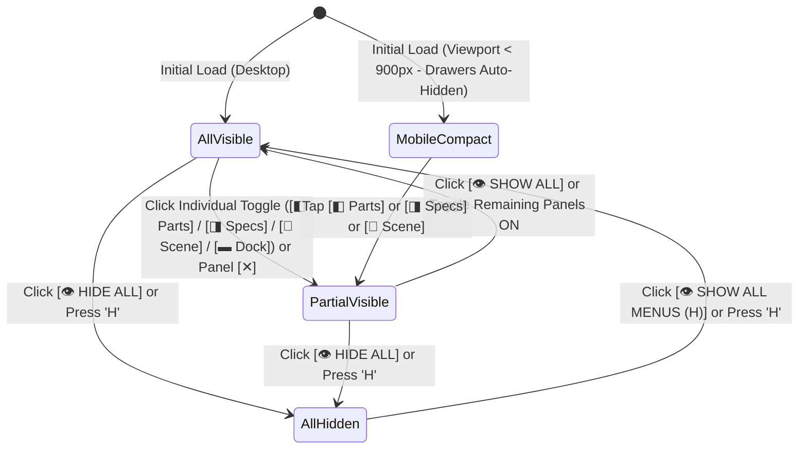

# Gundam-Like Mecha Enthusiast — 3D Engineering Hangar
## Comprehensive Application UI/UX Wireframe & Architecture Specification

> **Document Scope:** Full Application UI/UX Wireframe (Screen Layouts, Menu Show/Hide & Show/Hide All System, Algorithmic Reference Parts Catalog, 3D Viewport HUD, Render Modes, Lighting Presets, Portfolio Integration)  
> **Official Brand Designation:** `Gundam-Like Mecha Enthusiast — 3D Engineering Hangar` (Zero unauthorized trademarked names)  
> **Design Inspiration & Benchmarks:** Synthesized from `mecha-3d-showcase.vercel.app` (Orbitron/Inter Glass HUD, Custom GLSL Fresnel Hologram Shader, Planetary Lighting & Cyberpunk Floor, Corner Reticles, Studio Bloom) + `jurmy24/mechaverse` (Auto-Fit BoundingBox Camera, Neutral HDR IBL Lighting, Scrollable Card Selector & Filter Dropdown) + Algorithmic Reference Catalog (Scalable 100+ Agentic Parts Drawer).

---

## 1. Master Application Wireframe — All Menus Visible (`STATE: FULL_STUDIO`)

```
+=========================================================================================================================================================+
| [TOP-LEFT/CENTER FLOATING HEADER: #nav-header]                                                       [TOP-RIGHT PERSISTENT VISIBILITY BAR: #hud-vis-bar]|
| (●) GUNDAM-LIKE MECHA HANGAR  | [ 🌐 Portfolio Switcher ▾ ]  [ ⚔️ HERO RX-78 ] [ 👁️ RIVAL MS ]      | [◧ Parts] [◨ Specs] [🎨 Scene] [▬ Dock] | [👁️ HIDE ALL] |
+=========================================================================================================================================================+
| ┌───────────────────────────────────────┐                                                                            ┌────────────────────────────────┐ |
| │ [LEFT DRAWER: #left-drawer]           │   ┌──                                                                ──┐   │ [RIGHT DRAWER: #right-drawer]  │ |
| │ MODULAR PARTS CATALOG   [⛶] [✕ Hide]  │   │   (4x Corner Sci-Fi Reticles .corner-marker tl/tr/bl/br)           │   │ DIAGNOSTIC TELEMETRY [✕ Hide]  │ |
| ├───────────────────────────────────────┤   │                                                                    │   ├────────────────────────────────┤ |
| │ [🔍 Search parts, serial, HP...  [✕]] │   │                                                                    │   │ ● SYSTEM ONLINE   [60 FPS]     │ |
| ├───────────────────────────────────────┤   │                                                                    │   │ CHASSIS   RX-Type Ver.Ka Frame │ |
| │ [ALL(8)] [PACKS(5)] [WEAPONS(1)]      │   │                        \  /\  /   (Swept Gold V-Fin)               │   │ BASE MASS             24,500 kg│ |
| │ [ARMOR(1)] [VERNIERS(1)]              │   │                         \/[]\/    (Red Crest + Cyan Eyes)          │   │ PAYLOAD               +4,200 kg│ |
| ├───────────────────────────────────────┤   │                      ___/====\___ (Layered Pauldrons)              │   │ TOTAL MASS            28,700 kg│ |
| │ [📍 All 26 Stations ▾] [Sort: Def ▾]  │   │                     /  |[====]|  \ (Cobalt Chest + Gold Vents)     │   │ REACTOR OUTPUT        3,450 kW │ |
| ├───────────────────────────────────────┤   │                    |   | [##] |   | (Protruding Red Cockpit)       │   │ THRUST FORCE         82,000 kgf│ |
| │ Showing 8 of 8 parts   |  1 Equipped  │   │                    |   |\====/|   | (Hydraulics + Front Skirts)    │   │ VACUUM TWR              2.86 G │ |
| │ [✓ Equipped Only Toggle]              │   │                    |  /  |  |  \  | (Katoki Ver.Ka A-Stance)       │   │ CENTER OF MASS [0.0,48.0,-18.0]│ |
| ├───────────────────────────────────────┤   │                      /   |  |   \                                  │   │ AMBAC ENVELOPE:      ● NOMINAL │ |
| │ ┌───────────────────────────────────┐ │   │                     /  _/    \_  \ (Pentagonal Knee Wedges)        │   ├────────────────────────────────┤ |
| │ │ [PACK] GXM-MPK-AERO-01     [HP-00]│ │   │                    /  /        \  \ (Flared Bell Calves)           │   │ SELECTED INSPECTION NODE       │ |
| │ │ Type-A Atmospheric Superiority    │ │   │                   /__/          \__\ (3-Part Combat Boots)         │   │ V-Fin Phased-Array Antenna     │ |
| │ │ 4.2t | 82k kgf | 450kW | 3.0mm Pin│ │   │               ════════════════════════ (Reflective Hangar Pad)     │   │ Broadband directional array... │ |
| │ │ [ ✓ EQUIPPED — CLICK TO REMOVE ]  │ │   │                                                                    │   ├────────────────────────────────┤ |
| │ └───────────────────────────────────┘ │   │                                                                    │   │ [SCENE CONTROLS: #scene-panel] │ |
| │ ┌───────────────────────────────────┐ │   │                                                                    │   │ RENDER MODE          [✕ Hide]  │ |
| │ │ [WEAPON] GXM-WPN-BRIF-06   [HP-11]│ │   │                                                                    │   │ [◆ PBR] [◇ Holo] [▦ X-Ray]     │ |
| │ │ RX Beam Rifle Mk-II (E-Pac)       │ │   │                                                                    │   │ [📐 Blueprint] [⚙️ InnerFrame] │ |
| │ │ 0.9t | 0 kgf | 310kW | 3.0mm Pin  │ │   │                                                                    │   │ LIGHTING ENVIRONMENT           │ |
| │ │ [ + EQUIP TO CHASSIS ]            │ │   │                                                                    │   │ [🏗️Hangar][🌍Earth][🔴Mars]    │ |
| │ └───────────────────────────────────┘ │   │                                                                    │   │ [🌑Lunar][🏙️Cyberpunk]        │ |
| │          (Scrollable / Scalable       │   │                                                                    │   │ Auto-Rotate [●] Hover Idle [●] │ |
| │           for 100+ Agentic Parts)     │   └──                                                                ──┘   └────────────────────────────────┘ |
| └───────────────────────────────────────┘                                                                                                               |
|                                     ┌────────────────────────────────────────────────────────────────────────────┐                                      |
|                                     │ [BOTTOM CONTROL DOCK: #bottom-bar]                               [✕ Hide]  │                                      |
|                                     │ EXPLODED VIEW [===|-----------] 25% | CAM: [Heroic][Front][Head][Back] [↺] │                                      |
|                                     └────────────────────────────────────────────────────────────────────────────┘                                      |
+=========================================================================================================================================================+
```

---

## 2. Application Menu Show / Hide & Show / Hide All Architecture

To guarantee zero visual clutter on both wide desktop monitors and smaller laptops — while allowing instant unobstructed showcase photography of the 3D Mecha — every HUD menu is independently toggleable AND governed by a master **Show All / Hide All** controller.

### 2.1 Persistent Top-Right Visibility Controller (`#hud-vis-bar`)

This ultra-compact translucent floating pill stays anchored at `top: 12px; right: 16px; z-index: 100` across ALL states (even when all menus are hidden), ensuring the user is never stranded without controls.

#### State A: Menus Active (`allHidden === false`)
```
+-------------------------------------------------------------------------------+
| [◧ Parts ●]  [◨ Specs ●]  [🎨 Scene ●]  [▬ Dock ●]  │  [ 👁️ HIDE ALL (H) ]   |
+-------------------------------------------------------------------------------+
  ^ Active Cyan Pill = Panel Visible      ^ Dim Pill = Panel Hidden
```

#### State B: Cinema / Pure Showcase Mode (`allHidden === true`)
When the user clicks **`[👁️ HIDE ALL]`** (or presses keyboard hotkey **`H`**):
- `#nav-header` slides up (`translateY(-120%)`, `opacity: 0`, `pointer-events: none`)
- `#left-drawer` slides left (`translateX(-120%)`, `opacity: 0`, `pointer-events: none`)
- `#right-drawer` & `#scene-panel` slide right (`translateX(120%)`, `opacity: 0`, `pointer-events: none`)
- `#bottom-bar` slides down (`translateY(140%)`, `opacity: 0`, `pointer-events: none`)
- `#hud-vis-bar` collapses cleanly into a single subtle translucent button:

```
                                                                  +--------------------------+
                                                                  | [ 👁️ SHOW ALL MENUS (H) ] |
                                                                  +--------------------------+
```

100% of the viewport is now pure, unobstructed 3D WebGL canvas for inspecting, orbiting, zooming, and admiring the Gundam-Like Mecha.

### 2.2 Per-Menu Show / Hide Behavior Matrix

| Menu Module | DOM ID | Toggle Pill | Inline Close | Hidden CSS Transform | Purpose |
|---|---|---|---|---|---|
| **Left Parts Catalog** | `#left-drawer` | `[◧ Parts]` | `✕` in title bar | `translateX(calc(-100% - 24px))` | Algorithmic Reference searchable modular parts drawer (340px ↔ 480px) |
| **Right Telemetry HUD** | `#right-drawer` | `[◨ Specs]` | `✕` in title bar | `translateX(calc(100% + 24px))` | Real-time mass, reactor kW, thrust kgf, TWR, AMBAC CoG, node inspector |
| **Scene & Render Panel** | `#scene-panel` | `[🎨 Scene]` | `✕` in title bar | `translateX(calc(100% + 24px))` | Render modes (PBR / Hologram / X-Ray / Blueprint / Inner Frame) & Lighting presets |
| **Bottom Control Dock** | `#bottom-bar` | `[▬ Dock]` | `✕` in dock | `translateY(calc(100% + 24px))` | Exploded assembly slider (0–100%), camera presets, reset camera |
| **Top Nav Header** | `#nav-header` | Controlled by Master | — | `translateY(calc(-100% - 24px))` | Brand identity, portfolio switcher dropdown, Hero/Rival chassis selector |
| **Master Controller** | `#btn-toggle-all-hud` | **`[👁️ HIDE ALL]` / `[👁️ SHOW ALL]`** | Hotkey `H` | Always visible | Saves previous individual states before hiding; clicking `SHOW ALL` restores all panels cleanly |

### 2.3 State Transition Diagram (Menu Visibility)



---

## 3. Algorithmic Reference Catalog Drawer (Agentic Scalability Blueprint)

Because the autonomous CAD pipeline continuously generates new modular parts across 26 UHIS stations, `#left-drawer` mirrors the **Algorithmic Reference Catalog** scalability pattern:

1. **Compact Width (`340px`) & Expanded Grid Mode (`480px`)**: Toggle button `⛶` widens the drawer into a 2-column dense card grid for browsing 50–500+ agentic parts smoothly.
2. **Real-Time Multi-Field Search**: Filters by part name, serial number (`GXM-MPK-*`), hardpoint station (`HP-00`–`HP-26`), category, or operational role.
3. **Dynamic Category Filter Chips**: `ALL`, `PACKS`, `WEAPONS`, `ARMOR`, `VERNIERS` with live numeric counters automatically computed from `data/mecha_catalog.json`.
4. **26-Station Hardpoint Selector + Sort + Equipped-Only Filter**:
   - Filter by exact hardpoint (`HP-00` Dorsal Hub, `HP-07` Forearm Shield, `HP-11` Hand Weapon, `HP-13` Hip, `HP-17` Rear Skirt, `HP-21` Heel Recoil).
   - Sort by `Default`, `Name A–Z`, `Mass (Lightest)`, `Mass (Heaviest)`, `Thrust (Highest)`.
   - Quick toggle chip `✓ Equipped Only` to review active loadout instantaneously.
5. **Part Card Information Density**:
   - Header: Category badge + Serial number + Compatible Hardpoint pill.
   - Body: Concise tactical role + 3-metric inline spec strip (`Mass t`, `Thrust kgf`, `Draw kW`).
   - Action Footer: Full-width `[+ EQUIP TO CHASSIS]` ↔ `[✓ EQUIPPED — CLICK TO REMOVE]` button.

---

## 4. 3D Rendering, Sculpted Ver.Ka Geometry & Lighting Architecture

### 4.1 Sculpted Master Grade / Ver.Ka Geometry Standard (Strict Anti-Box Mandate)
Primitive rectangular boxes are strictly banned. Every chassis is compiled from **beveled, lofted, extruded polygonal & revolved CAD solids** in `src/mecha_engine/cad_compiler.py` and exported as multi-node Khronos glTF 2.0 `.glb` assemblies:

- **Hero Gundam-Like Ver.Ka Frame (`baseline_gundam_frame_v1.glb`)**:
  - **Katoki Ver.Ka Heroic A-Stance ("Katoki-dachi")**: Angled legs (`±6.5°` hip abduction), planted toed-out feet (`±9°`), confident flared shoulders (`±8°`), slightly flexed elbows (`12°`), tucked chin (`4°` fierce glare).
  - **Sculpted Head**: Tapered faceted helmet dome, raised central mohawk crest with front & rear glowing cyan main cameras, recessed dark visor shadow, fierce angular glowing cyan twin eyes, sculpted white faceplate with cheek vents, crimson angular chin guard, twin temple Vulcan barrels, sweeping sharp **Double-V Metallic Gold V-Fin Blades** + crimson pentagonal forehead jewel.
  - **Sculpted Torso & Waist**: V-tapered faceted Federation Cobalt Blue chest, protruding faceted crimson cockpit hatch with silver upper trim, recessed dark chest ducts with angled gold intake louvers, swept white clavicle collar, faceted red core-fighter abdomen, gunmetal inner waist frame with twin polished chrome hydraulic dampers.
  - **Sculpted Pelvis & Skirts**: Central crotch core with gold V-emblem, hinged trapezoidal Front Skirt flaps (L/R), layered Side Skirts (L/R), flared Rear Skirt with underside thruster ports.
  - **Sculpted Arms**: Layered flared Ver.Ka Shoulder Pauldrons with outer thruster vents, chamfered octagonal biceps, exposed dual-disc mechanical elbow joints with chrome pistons, sleek tapered forearm gauntlets with HP-07 hardpoints, sculpted armored mecha fists.
  - **Sculpted Legs & Feet**: Tapered athletic thighs, protruding **Ver.Ka Pentagonal Knee Armor Wedges**, dramatically **Flared Aerodynamic Calves** with sharp shin ridge + rear calf supersonic thruster nozzles, floating ankle guard cuffs, segmented 3-piece combat feet (white instep armor, red angled toe wedge, red heel spur, gunmetal tread sole).
  - **Dorsal Ver.Ka Backpack**: Faceted navy-slate thruster pack, dual angled supersonic de Laval rocket bells with glowing inner nozzles, **dual upright Beam Saber Hilts** angled behind shoulders, plus universal UHIS HP-00 dovetail hub.
- **Rival Heavy Mono-Eye Commander (`baseline_rival_heavy_frame_v1.glb`)**:
  - Sazabi / Sinanju / Zaku-II Commander Ver.Ka silhouette: Swept curved dome helmet with flared samurai neck guard, black visor slit + blazing glowing **Ruby Red Mono-Eye**, swept commander forehead blade, segmented braided metallic energy conduit beads around cheeks and waist, crimson-metallic sloped torso, left massive curved dome pauldron with **3 sharp conical kinetic ramming spikes**, right multi-layered curved **Heavy Shield Binder**, long swept heavy skirts, massive **Flared Bell-Bottom Hover Legs** with triple hover thruster nozzles, and heavy dorsal funnel/booster pack with universal HP-00 socket.

### 4.2 Studio WebGL Pipeline (Learned from `mecha-3d-showcase` & `mechaverse`)
1. **PMREM Studio Environment Map (`RoomEnvironment`)**: Provides photorealistic specular reflections on metallic gold V-fins, gunmetal titanium inner frames, chrome hydraulic pistons, and satin white Ver.Ka armor.
2. **Post-Processing (`EffectComposer` + `UnrealBloomPass`)**: Subtle controlled bloom (`threshold: 0.92`, `strength: 0.55`, `radius: 0.35`) makes the twin cyan optics, camera crest, ruby mono-eye, plasma thrusters, and Hologram shader glow cleanly without washing out armor details.
3. **5 Interactive Render Modes**:
   - `◆ Standard PBR`: Full Ver.Ka materials + studio IBL + shadows.
   - `◇ Hologram`: Custom GLSL Fresnel + scrolling scanlines + scan bar + micro-glitch shader (`#00e5ff`) + internal cyan core point light.
   - `▦ X-Ray`: Translucent cyan CAD wireframe geometry inspection.
   - `📐 Blueprint`: Dark architectural navy body overlaid with crisp glowing cyan `THREE.EdgesGeometry` mechanical panel lines.
   - `⚙️ Inner Frame`: Master Grade Armor Purge — hides outer armor cowlings to expose the titanium Movable Frame, joint discs, spine, and hydraulic dampers.
4. **5 Planetary & Hangar Lighting Presets**:
   - `🏗️ Hangar Studio` (Balanced studio key/fill/rim + glowing circular docking pad & tactical hex floor)
   - `🌍 Earth Orbit` (Bright solar white key + atmospheric azure fill + starfield)
   - `🔴 Mars Dust` (Warm burnt-amber key + terracotta rim + dusty backdrop)
   - `🌑 Lunar Contrast` (Harsh unfiltered white key + deep space shadows + dense starfield)
   - `🏙️ Cyberpunk` (Deep violet void + high-intensity neon magenta & cyan rim lights + glossy reflective floor + floating glowing neon accents)
5. **Auto-Fit Camera & Presets**:
   - Uses `THREE.Box3().setFromObject(mechaRoot)` auto-centering + isometric 3/4 heroic default angle (`Heroic 3/4`, `Front`, `Head Close-Up`, `Dorsal Pack`, `Low Titan`).
   - Smooth `Auto-Rotate` toggle & subtle `Hover Idle` zero-G float animation.

---

## 5. Cross-Portfolio Integration Wireframe (`index.html` & Ecosystem)

### 5.1 Main Portfolio Hero Button Row (`index.html`)
Every flagship interactive lab sits side-by-side in the Hero CTA bar:

```
+----------------------------------------------------------------------------------------------------------------------------+
|  [🏢 3D Virtual Office (24/7)]  [🌌 View 3D Constellation]  [🤖 3D Gundam-Like Hangar]  [📊 Macro App ↗]  [🐙 GitHub] [in] |
|                                         [ Browse Algorithms & Agentic Papers ↓ ]                                           |
+----------------------------------------------------------------------------------------------------------------------------+
```

### 5.2 Flagship Showcase Grid (`index.html`)
4 balanced flagship cards:
1. `🏢 3D Virtual Office (24/7)` → `office.html`
2. `🌌 3D Cosmic Constellation` → `constellation.html`
3. `🤖 Gundam-Like Mecha Enthusiast — 3D Engineering Hangar` → `mecha.html`
4. `🌐 Macro Economic Analysis & AI Market Intelligence` → `https://economic-analysis-three.vercel.app/?lang=en`

### 5.3 Cross-Links & Typography Integrity
- Top navigation dropdown (`🌐 3D Interactive Lab ▾`) in `index.html`, portfolio switcher dropdown in `mecha.html`, `office.html`, `constellation.html`, and GitHub profile README (`profile_builder.py`) all link cleanly to `mecha.html` as **3D Gundam-Like Hangar**.
- Zero raw LaTeX escapes (`C\#` / `C\\#`) across `data_collector.py`, `paper_landing_generator.py`, `index.html`, and all `papers/*/index.html` landing pages — always clean `C#`.
